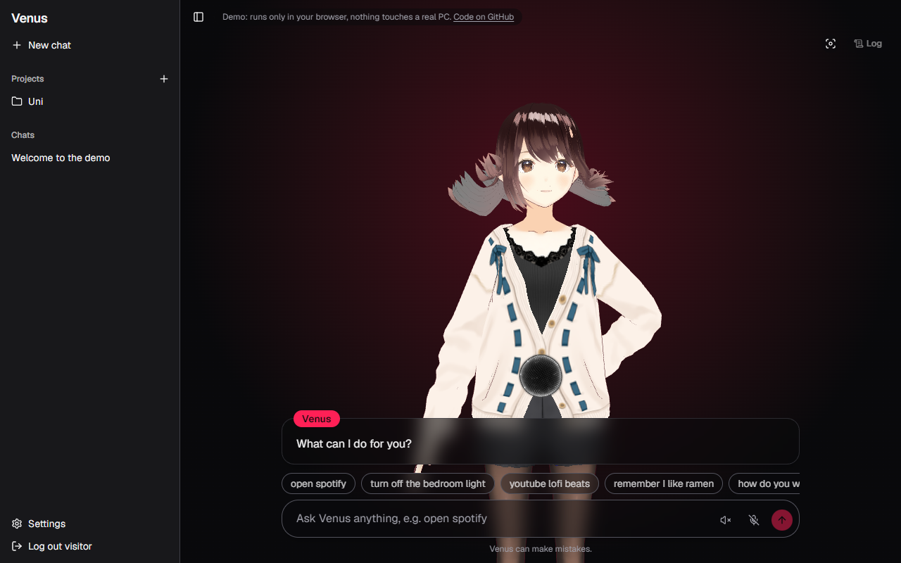

# Venus

My own assistant that lives on my PC. I say "Hey Venus", she opens my apps,
sites and code projects, controls my lights and TV, reads my calendar,
chats with me, remembers what I tell her and talks back. A 3D version of
her sits on the web page.

**[Install](guide/install.md)** · [Guides](#guides) · [Roadmap](ROADMAP.md) ·
[Contributing](CONTRIBUTING.md) · [Security](SECURITY.md)



<sub>The default character (pixiv's free VRoid sample). You can upload your own.</sub>

Self-hosted: everything runs on your own PC, nothing is hosted for you, and
you bring your own API keys. Works on **Windows 10/11**, **macOS** and
**Linux**.

## How I built it

I'm a beginner, and Venus is how I'm learning to build real software: a
server, a database, a web page and a desktop app that all talk to each
other, instead of tutorials.

I built it with [Claude Code](https://claude.com/claude-code) (an AI coding
tool), but set up as a **mentor**, not a code machine. So it's not "fully
written by me", and it's not blind vibe coding either:

- **I decide what Venus is.** Most features came from me using her every
  day and asking for things ("she should remember stuff", "control my
  lights", "work on my phone").
- **Claude teaches before building.** For each design choice it explains
  the options, pros and cons (why PostgreSQL, why a WebSocket, why
  Tailscale and not a public link), and I pick.
- **Early parts I typed myself** from hints. Later, to finish the project,
  Claude wrote most of the code while I tested it live on my PC, found the
  bugs and decided what stays.
- **Everything goes through the same checks**: one pull request per
  feature, about 950 automated tests, and CI on Windows, Linux and macOS.

A big part of what I learned is the setup around the AI itself, like
building my own harness: a teaching mode (the
[VibeWise](https://github.com/nykooi1/vibe-wise) skill), handoff notes so
each session continues where the last stopped, a decisions log, and rules
like "explain first, then code". Next I'm going through the whole codebase
to understand every part myself.

## What she can do

Type these in the chat, or say "Hey Venus" first and then say them.

| You say | What happens |
| --- | --- |
| `open spotify` / `open github.com` | Opens an app from your Start menu, or a link |
| `youtube lofi beats` | Searches YouTube (also `google ...`, `netflix ...`) |
| `open project venus` | Opens that code project in VS Code |
| `remember I have class at 9 on mondays` | Saves it and uses it later in chats |
| `turn off the bedroom light` / `set the aircon to 24` | Lights, plugs, TV, air-con and scenes (Home Assistant or Tuya) |
| `what's on today?` / `add gym tomorrow at 6` | Her own calendar page, plus Google, Outlook and timetable (.ics) calendars |
| Email page | Your inbox, summed up by Luna, replies she drafts for you to check and send |
| `what should I cook tonight?` | Normal chat with the AI |
| `stop Venus` / `thank you Venus` | Cuts her off / ends the voice chat |

PC actions ask first (an Approve button in the chat), unless you switch to
Full mode in Settings. She can only open apps from your menu, web links and
folders in your projects folder, nothing else.

Also: offline "Hey Venus" wake word, her voice through
[Fish Audio](https://fish.audio/), a 3D character you can swap, switchable
personalities, a memory page you can edit, a cost meter for the AI, use
from your phone over Tailscale (private, not public), and more PCs joining
the same Venus.

## Quick start

1. Install [Docker Desktop](https://www.docker.com/products/docker-desktop/)
   and [Python 3.11+](https://www.python.org/downloads/) (tick "Add to
   PATH"). Open Docker once.
2. Download Venus: `git clone https://github.com/Umrkimy/Venus.git`, or
   **Code, Download ZIP** on this page.
3. Double-click `setup-venus.cmd` (Linux: `./setup-venus.sh`). It makes your
   settings and secrets for you and asks for a username and password.
4. Open <http://localhost:3000>, sign in, and add your OpenAI and Fish Audio
   keys in **Settings**.
5. **Before you rely on it**, open `apps/node/.env` once and check your
   projects folder, wake words and mic.
   [Which files to change, and which never to touch.](guide/install.md#5-check-your-settings-files)

After that, start Venus with the **Venus** icon on your desktop or Start
menu (or `start-venus-use.cmd`). The
[full install guide](guide/install.md) explains every step slowly.

## Guides

- [Install and settings](guide/install.md): step by step, what each `.env` file is
- [Home control](guide/home-control.md): lights, plugs, TV, waking a PC
- [Calendar](guide/calendar.md): the Calendar page, Google, Outlook and timetables
- [Email](guide/email.md): inbox, summaries and replies
- [Phone, own domain and other PCs](guide/remote-access.md)
- [Backups and troubleshooting](guide/backups-and-troubleshooting.md)
- [Developing](guide/developing.md): run from source, tests

## How it fits together

```text
 Browser / phone ──> Web (Next.js, :3000) ──> Core (FastAPI, :9000) ──> Postgres
                                               │
                                               └─ WebSocket ──> Node (the PC app)
                                                                 opens apps, "Hey Venus",
                                                                 orb + tray icon
```

| Part | Folder | What it is |
| --- | --- | --- |
| Core | `apps/core` | The brain: saves chats, memories and settings, talks to the AI, sends commands to your PCs |
| Web | `apps/web` | The page at `http://localhost:3000`: chat, settings, 3D Venus |
| Node | `apps/node` | The tray app on each PC: runs commands, listens for "Hey Venus" |
| Protocol | `packages/venus-protocol` | Message formats Core and Node share |

Core, the web page and Postgres run in Docker. The Node runs straight on
your PC, because it has to open your apps and use your mic.

## Security

Venus can open things on your PC, so it's locked down: everything listens
only on your own PC (other devices come in through Tailscale), passwords
are hashed, saved keys are encrypted, each PC has its own revocable token,
and the PC app re-checks every command itself. Details and how to report a
problem: [SECURITY.md](SECURITY.md).

## Portfolio

A small demo of Venus is coming to my portfolio at
[umrkimy.dev](https://umrkimy.dev).

## License

[MIT](LICENSE). The default 3D character is pixiv's VRoid sample model,
under [its own terms](apps/web/public/models/CREDITS.md).

## Acknowledgements

- [Claude Code](https://claude.com/claude-code), my coding mentor, with the
  [VibeWise](https://github.com/nykooi1/vibe-wise) teaching skill
- [FastAPI](https://fastapi.tiangolo.com/), [PostgreSQL](https://www.postgresql.org/),
  [Next.js](https://nextjs.org/), [shadcn/ui](https://ui.shadcn.com/)
- [@pixiv/three-vrm](https://github.com/pixiv/three-vrm) and the VRoid sample model
- [Vosk](https://alphacephei.com/vosk/) (wake word), [Fish Audio](https://fish.audio/) (voice)
- [tinytuya](https://github.com/jasonacox/tinytuya), [pychromecast](https://github.com/home-assistant-libs/pychromecast)
- [Tailscale](https://tailscale.com) and [Caddy](https://caddyserver.com)
- README layout inspired by [Odysseus](https://github.com/odysseus-dev/odysseus)
